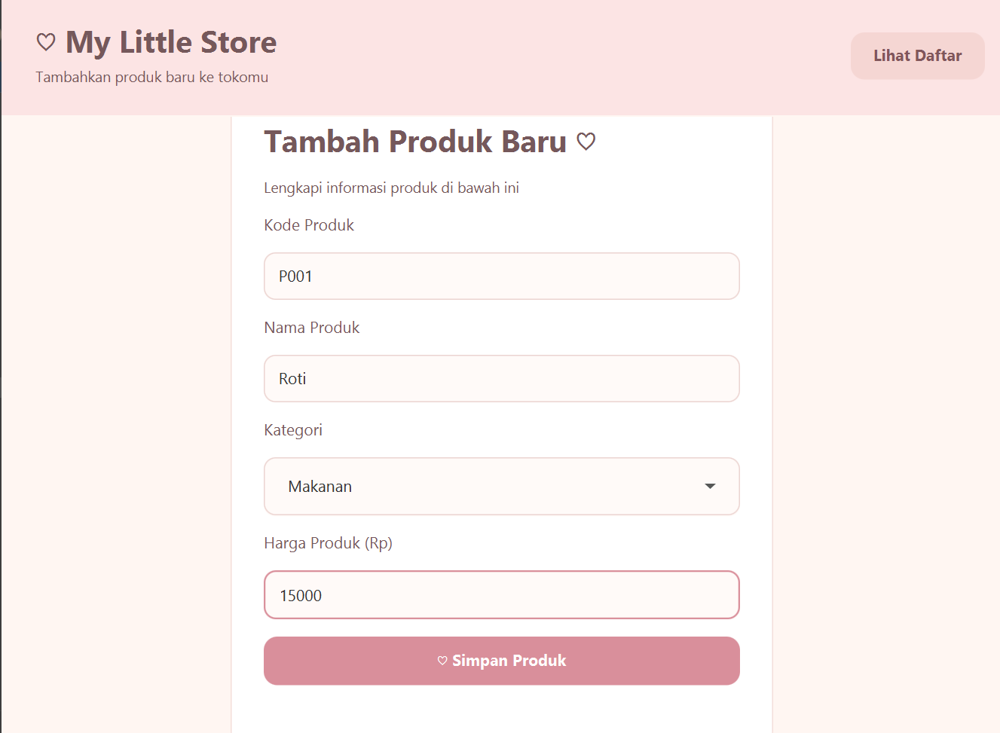
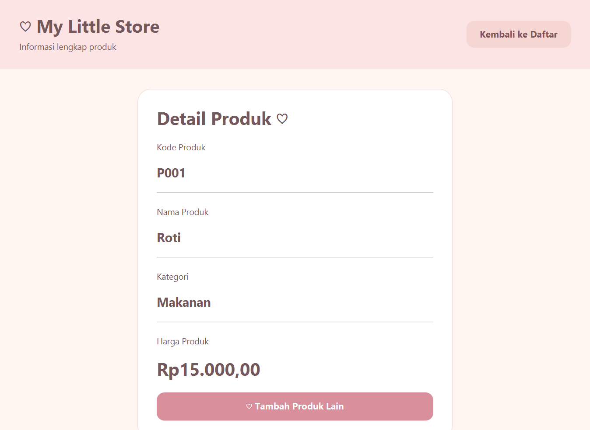
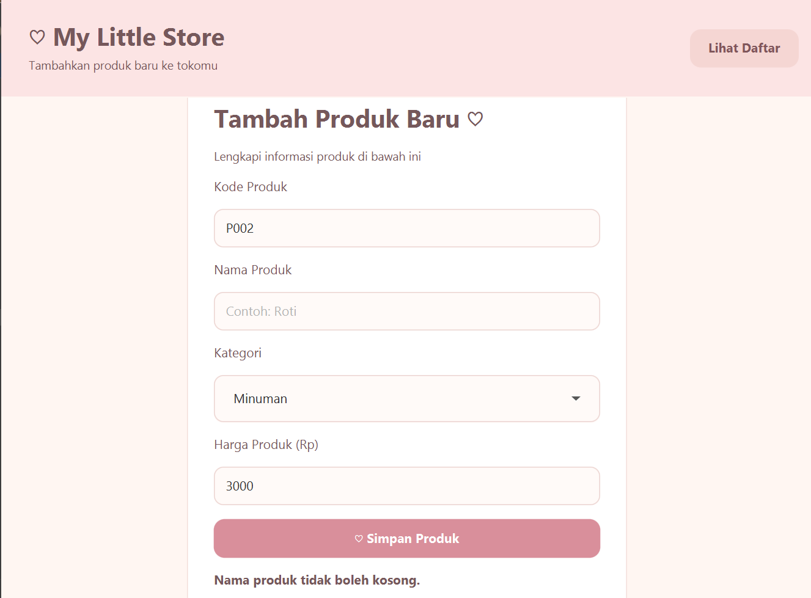
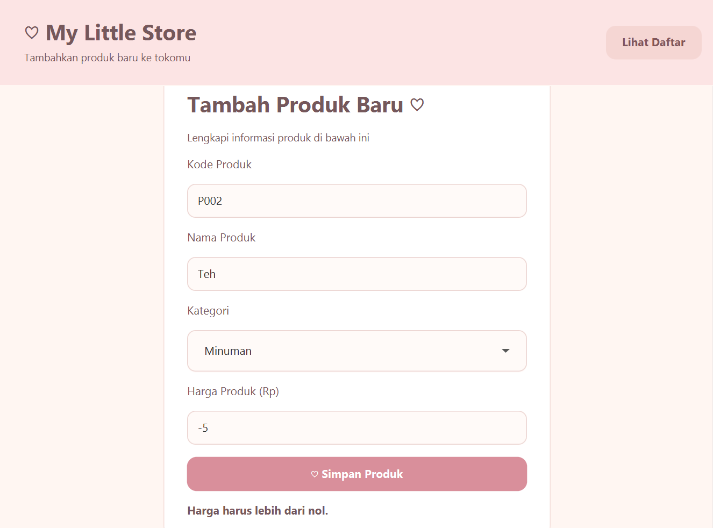
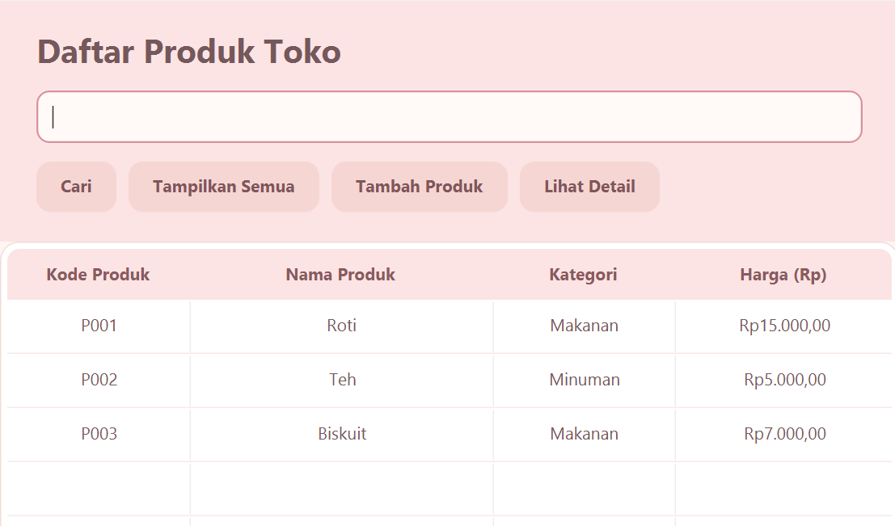
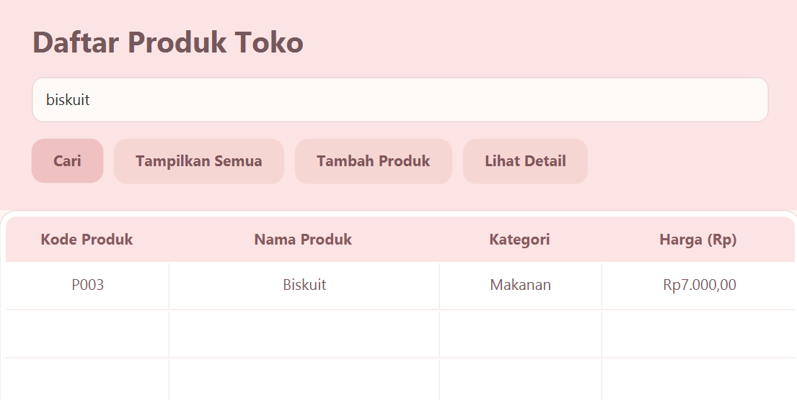

# Product Manager App

Aplikasi ini dibuat menggunakan **JavaFX** dan **Maven** untuk membantu proses pendataan serta pengelolaan produk toko secara praktis. Sistem ini menyediakan antarmuka visual untuk mencatat barang, melakukan pencarian, serta melihat rincian detail setiap produk.

---

## Fitur Utama

- **Form Tambah Produk**: Memudahkan pendaftaran barang baru dengan pilihan kategori (Makanan/Minuman).
- **Validasi Input Otomatis**: Mencegah kesalahan input dengan menolak nama produk yang kosong serta nominal harga yang bernilai 0 atau negatif.
- **Tabel Daftar Produk**: Menampilkan seluruh data produk (Kode, Nama, Kategori, dan Harga) dalam bentuk tabel.
- **Sistem Pencarian**: Fitur untuk menyaring dan menemukan produk berdasarkan kata kunci nama.
- **Halaman Detail Produk**: Menampilkan informasi lengkap beserta galeri foto produk yang terpilih.

---

## Cara Menjalankan Aplikasi

### Melalui Terminal / Command Prompt

1. **Clone Repositori**  
   Unduh repositori dari GitHub ke komputer Anda:
   ```bash
   git clone https://github.com/shabrinaputri2409-ops/ProdukToko.git
   ```

2. **Masuk ke Direktori Proyek**  
   Arahkan terminal ke dalam folder utama proyek:
   ```bash
   cd DaftarProdukToko
   ```

3. **Jalankan Aplikasi**  
   Eksekusi perintah Maven berikut untuk mengompilasi dan membuka aplikasi:
   ```bash
   mvn clean javafx:run
   ```

*(Note: Jika menggunakan IDE seperti NetBeans, Anda dapat langsung memilih menu **Open Project**, pilih folder **DaftarProdukToko**, lalu tekan tombol **Run**).*

---

## Tampilan Aplikasi

#### 1. Formulir Tambah Produk


#### 2. Halaman Detail Produk


#### 3. Validasi Form (Nama Kosong Ditolak)


#### 4. Validasi Form (Harga Negatif/Nol Ditolak)


#### 5. Tabel Utama Daftar Produk


#### 6. Pencarian Produk Berdasarkan Nama

